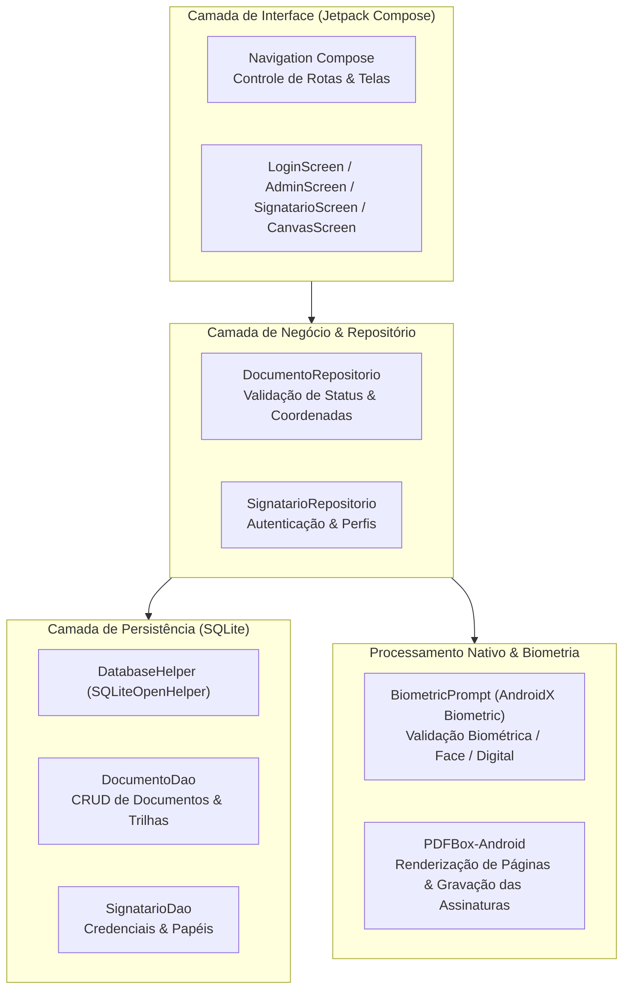

# BestSign — Assinatura Eletrônica e Gestão de Documentos PDF

**Autor:** Renan Santa Rosa Xavier — RM566997 | 🌐 **Portfólio:** [renan-xavier.vercel.app](https://renan-xavier.vercel.app)

---

## 📌 Visão Geral do Projeto

O **BestSign** é um aplicativo nativo para Android voltado à assinatura eletrônica segura e descomplicada de contratos PDF pelo smartphone.

O projeto resolve o problema da baixa alfabetização digital e da burocracia na assinatura de contratos: permite ao administrador carregar um PDF, posicionar de forma proporcional os campos onde cada signatário deve assinar e enviá-lo. O signatário pode assinar via **autenticação biométrica do aparelho** (que gera um carimbo cursivo autenticado) ou desenhando manualmente na tela em um **Canvas dedicado**.

---

## 🎬 Demonstração do Sistema

### Vídeo de Demonstração no YouTube
Confira o fluxo completo do aplicativo no YouTube (envio do contrato, biometria e auditoria):

> 🔗 **Assistir no YouTube:** [Bestsign — Demonstração das Funções](https://www.youtube.com/watch?v=xK8ZsPvU6fY)

### Galeria de Telas do Aplicativo

#### 1. Autenticação, Painel do Administrador e Signatários
| Login Individual | Painel do Administrador | Gestão de Signatários |
| :---: | :---: | :---: |
|  |  |  |

#### 2. Criação do Documento, Posicionamento no PDF e Envio
| Upload / PDF Modelo | Seleção e Papéis | Posicionamento Proporcional | Revisão e Envio |
| :---: | :---: | :---: | :---: |
|  |  |  |  |

#### 3. Experiência do Signatário: Biometria ou Desenho Manual em Canvas
| Painel do Signatário | Destaque no PDF | Escolha da Assinatura | Biometria Nativa | Desenho no Canvas |
| :---: | :---: | :---: | :---: | :---: |
|  |  |  |  |  |

#### 4. Confirmação, PDF Assinado e Trilha de Auditoria
| Confirmação Digital | PDF Assinado (Parcial) | PDF Concluído (Todos) | Histórico e Auditoria |
| :---: | :---: | :---: | :---: |
|  |  |  |  |

---

## 🏛️ Arquitetura da Solução

O aplicativo segue o padrão Repository, separando a camada visual dos DAOs locais e dos serviços de arquivo:

---

## 🛠️ Tecnologias Utilizadas

| Tecnologia | Finalidade no Aplicativo |
| :--- | :--- |
| **Kotlin 2.0** | Linguagem moderna e concisa para desenvolvimento Android nativo. |
| **Jetpack Compose (Material 3)** | UI declarativa com componentes modernos do Material Design 3 e animações nativas. |
| **Navigation Compose** | Gerenciamento de rotas e passagem de parâmetros entre telas no Compose. |
| **SQLite Nativo (`SQLiteOpenHelper`)** | Banco de dados relacional embarcado com DAOs dedicados para signatários e documentos. |
| **BiometricPrompt API** | Autenticação biométrica nativa do sistema operacional (impressão digital ou reconhecimento facial). |
| **PDFBox-Android** | Biblioteca para manipulação de arquivos PDF, extração de páginas e gravação de assinaturas nas coordenadas proporcionais. |
| **Android Canvas API** | Quadro de desenho para captura de assinatura manuscrita com suavização de traço. |

---

## 🔑 Credenciais Pré-Cadastradas para Teste

O banco de dados local inicia pré-populado com contas de demonstração:

| Perfil | Nome | E-mail | Senha | Papel |
| :--- | :--- | :--- | :--- | :--- |
| **Administrador** | Admin BestSign | `admin@bestsign.com` | `123456` | Gestão e Envio de Documentos |
| **Signatário 1** | Carlos Eduardo Silva | `carlos@email.com` | `123456` | Contratante |
| **Signatário 2** | Mariana Costa Souza | `mariana@email.com` | `123456` | Contratado |

---

## 🚀 Como Executar o Projeto

1. Abra o **Android Studio**, clique em **Open** e selecione a pasta raiz `BestSign`.
2. Aguarde a sincronização do Gradle e execute o projeto em um emulador ou dispositivo físico com **Android 7.0+ (API 24+)**.
3. Acesse como **Administrador** (`admin@bestsign.com` / `123456`) para posicionar campos no PDF e enviar aos signatários.
4. Alterne para um **Signatário** (`carlos@email.com` / `123456`) para testar a assinatura via biometria ou canvas.
