# BestSign — Assinatura Eletrônica e Gestão de Documentos PDF

**Autor:** Renan Santa Rosa Xavier — RM566997 | 🌐 **Portfólio:** [renan-xavier.vercel.app](https://renan-xavier.vercel.app)

---

## 🎬 Demonstração em Vídeo do Aplicativo

Veja na prática o funcionamento do BestSign com envio de documento, posicionamento de campos, assinatura com biometria e trilha de auditoria:

> 🔗 **Assistir no YouTube:** [Bestsign — Demonstração das Funções](https://www.youtube.com/watch?v=xK8ZsPvU6fY)

---

## Visão Geral do Projeto

### O Problema
Processos de assinatura de contratos e documentos em formato PDF frequentemente enfrentam dois gargalos principais:
1. **Dificuldade de usabilidade:** Signatários com pouca familiaridade tecnológica ou idade avançada muitas vezes não encontram onde devem assinar ou abandonam fluxos complexos.
2. **Falta de isolamento e rastreabilidade:** Compartilhamento indevido de credenciais e ausência de clareza sobre o papel contratual (Contratante, Contratado ou Testemunha) e o histórico de auditoria do documento.

### A Solução
O **BestSign** é um aplicativo nativo Android voltado ao envio, posicionamento proporcional de campos, assinatura eletrônica (manuscrita em Canvas ou cursiva com autenticação biométrica) e acompanhamento completo de documentos PDF pelo celular.

---

## Galeria de Telas do Aplicativo

### 1. Autenticação, Painel Administrativo e Gestão de Signatários
| Login Individual | Painel do Administrador | Gestão de Signatários |
| :---: | :---: | :---: |
| 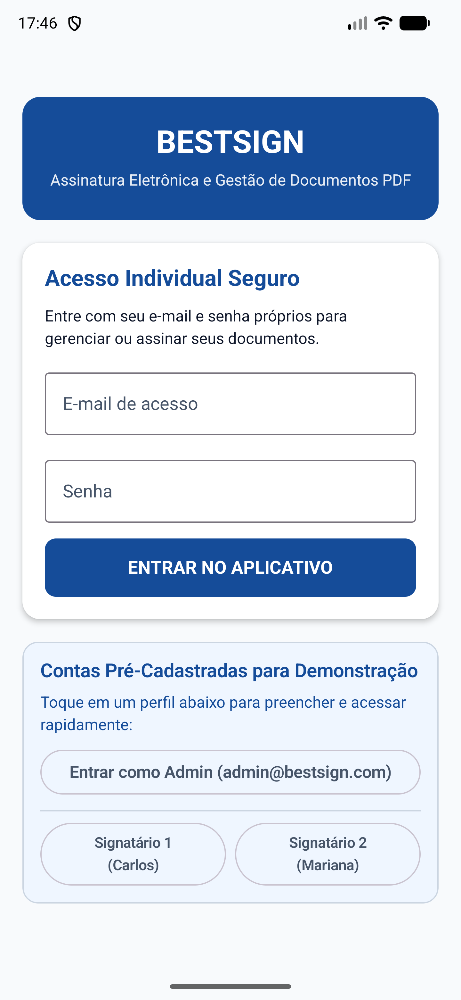 | 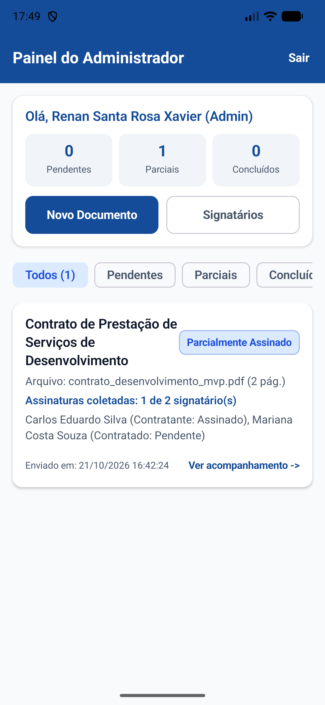 | 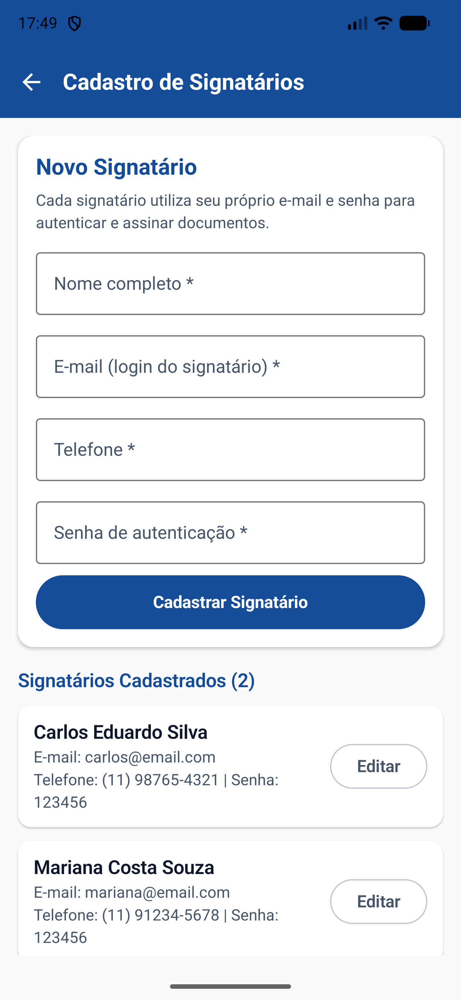 |

### 2. Criação do Documento, Posicionamento no PDF e Envio
| Upload / PDF Modelo | Seleção e Papéis | Posicionamento Proporcional | Revisão e Envio |
| :---: | :---: | :---: | :---: |
| 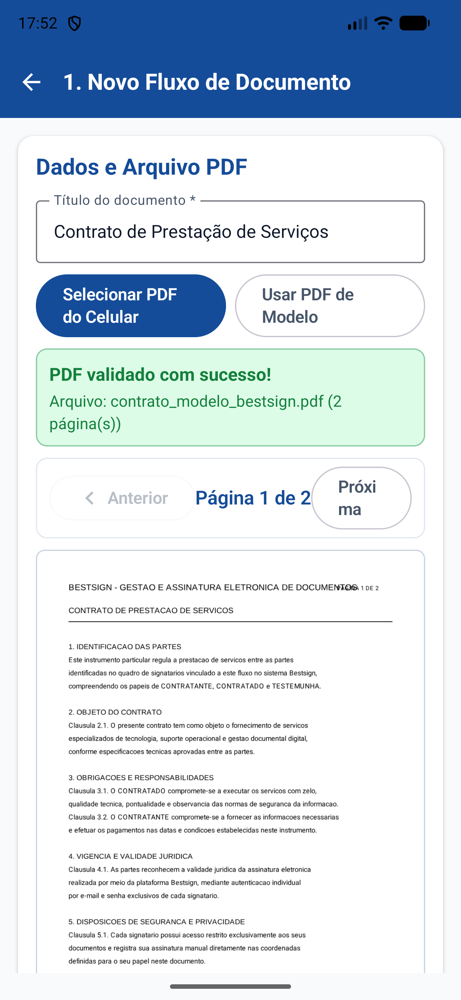 | 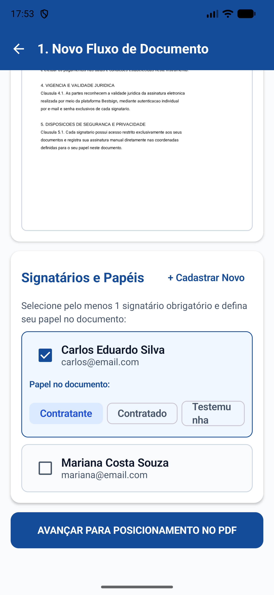 | 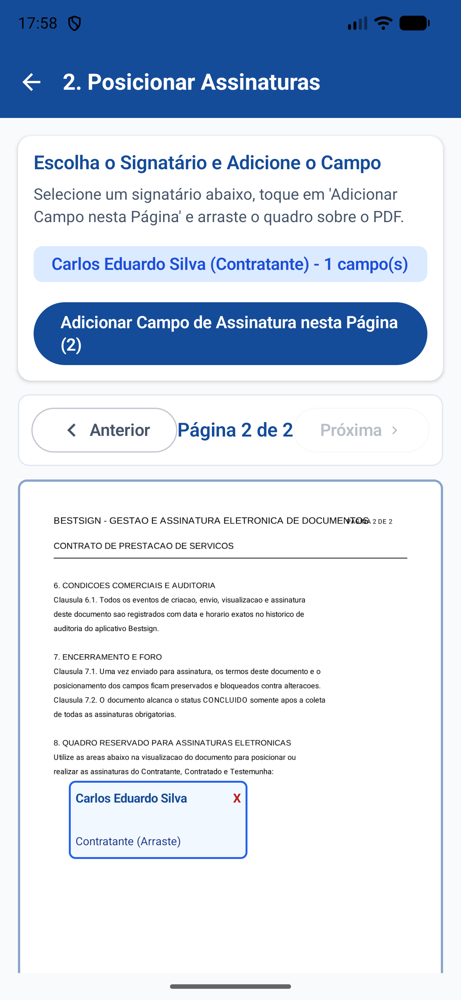 | 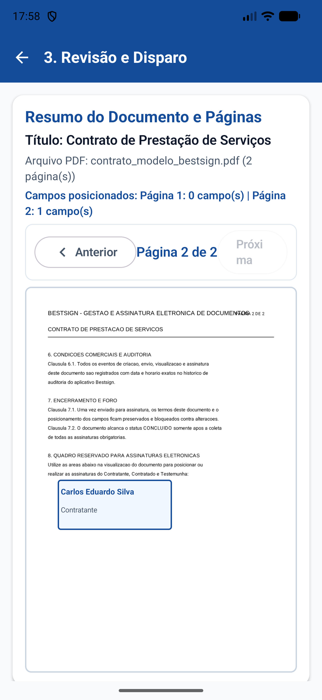 |

### 3. Experiência do Signatário: Biometria ou Desenho Manual em Canvas
| Painel do Signatário | Destaque no PDF | Escolha da Assinatura | Biometria Nativa | Desenho no Canvas |
| :---: | :---: | :---: | :---: | :---: |
| 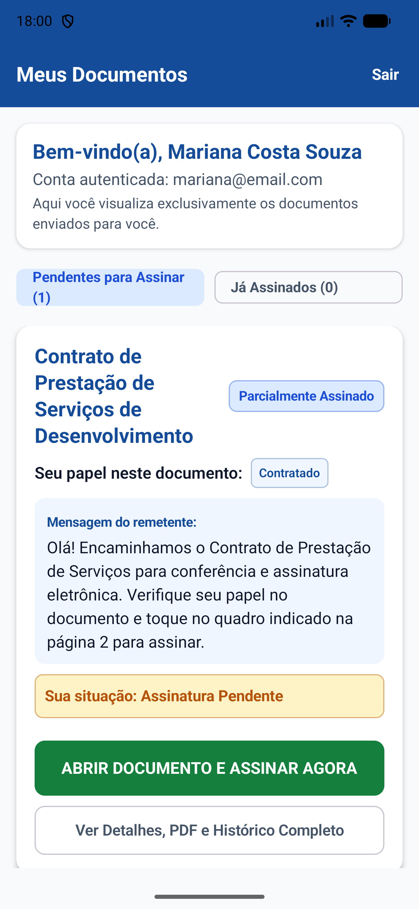 | 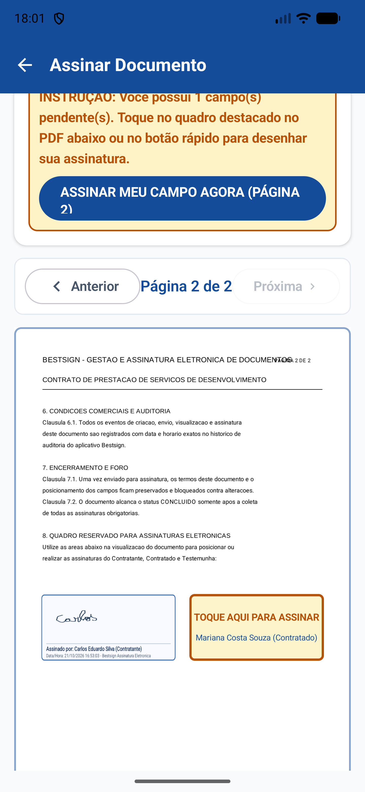 | 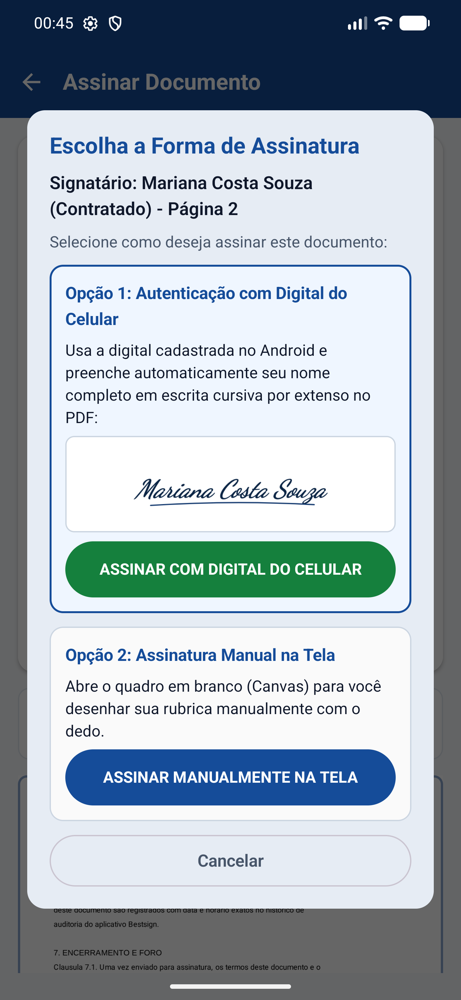 |  | 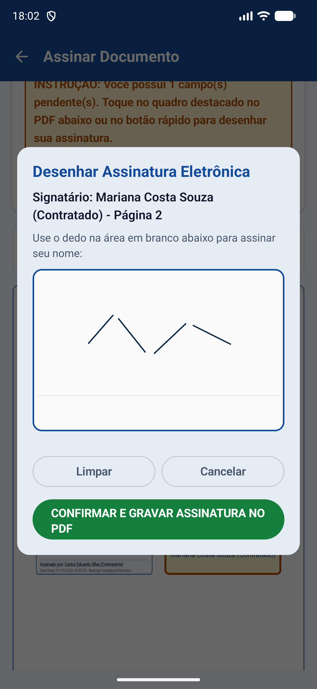 |

### 4. Confirmação, PDF Assinado e Trilha de Auditoria
| Confirmação Digital | PDF Assinado (Parcial) | PDF Concluído (Todos) | Histórico e Auditoria |
| :---: | :---: | :---: | :---: |
| 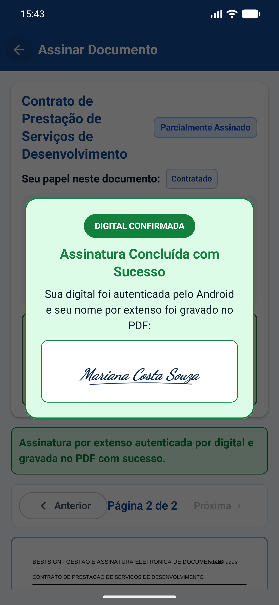 | 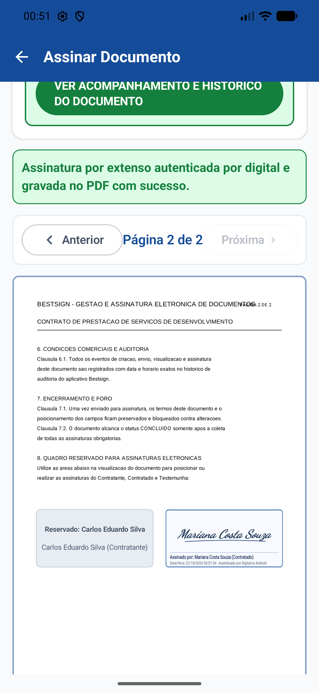 | 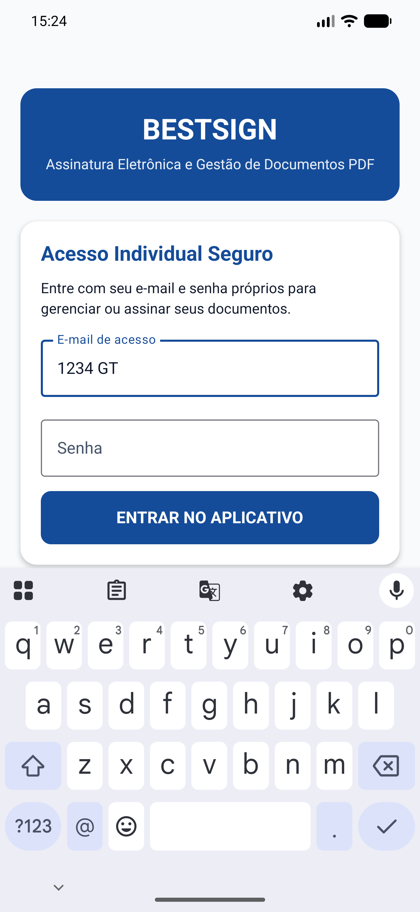 | 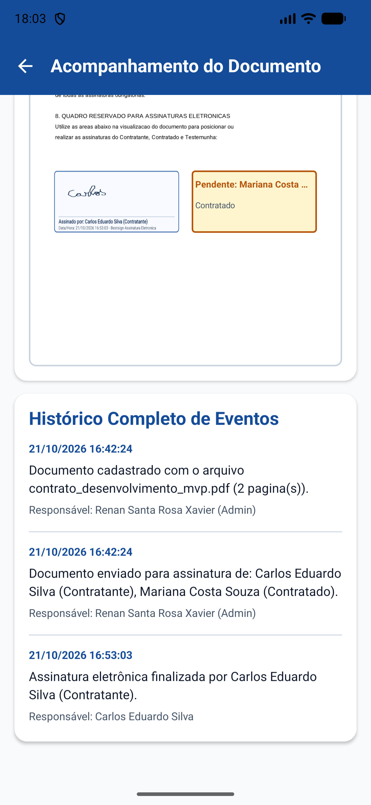 |

---

## Arquitetura e Tecnologias Utilizadas

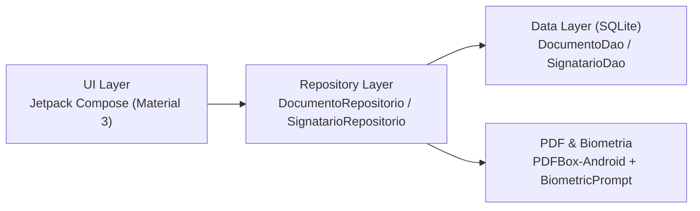

- **Desenvolvimento:** Android Nativo em Kotlin com Jetpack Compose (Material 3 e Navigation Compose).
- **Banco de Dados Local:** SQLite nativo (`SQLiteOpenHelper`) com DAOs dedicados (`SignatarioDao` e `DocumentoDao`).
- **Arquitetura em Camadas:** Padrão Repository isolando o acesso ao banco local e ao sistema de arquivos.
- **Manipulação de PDF e Assinatura:**
  - `Canvas` nativo para captura do desenho manual da assinatura.
  - Geração automática de assinatura cursiva por extenso após autenticação biométrica nativa (`BiometricPrompt`).
  - `PDFBox-Android` (`com.tom-roush:pdfbox-android`) para renderização das páginas e gravação definitiva das assinaturas nas coordenadas proporcionais selecionadas.

---

## Credenciais de Teste Pré-Cadastradas

O banco de dados local já inicia pré-populado com 1 conta de Administrador, 2 contas de Signatários e 1 contrato PDF de demonstração:

| Perfil | Nome | E-mail | Senha | Papel |
| :--- | :--- | :--- | :--- | :--- |
| **Administrador** | Admin BestSign | `admin@bestsign.com` | `123456` | Gestão e Envio |
| **Signatário 1** | Carlos Eduardo Silva | `carlos@email.com` | `123456` | Contratante |
| **Signatário 2** | Mariana Costa Souza | `mariana@email.com` | `123456` | Contratado |

---

## Como Executar o Projeto

1. Abra o **Android Studio**, clique em **Open** e selecione a pasta raiz do projeto `BestSign`.
2. Aguarde a sincronização do Gradle e execute o aplicativo em um emulador ou dispositivo Android (**API 24+**).
3. Faça login como **Administrador** (`admin@bestsign.com` / `123456`) para criar documentos, posicionar campos de assinatura sobre o PDF e enviar para os signatários.
4. Alterne para um **Signatário** (`carlos@email.com` ou `mariana@email.com` / `123456`) para visualizar o campo destacado no PDF e assinar via **Biometria do Android** ou **Desenho Manual na Tela**.
